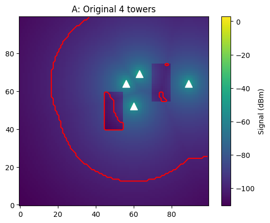
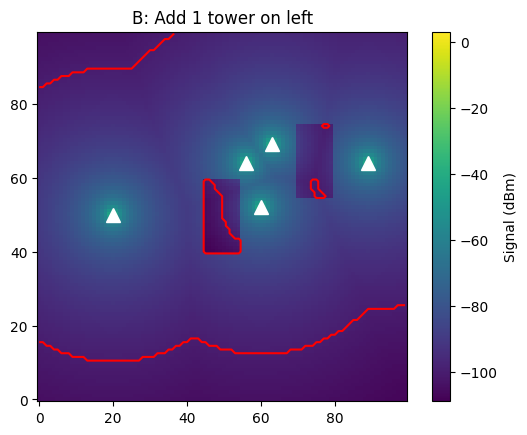
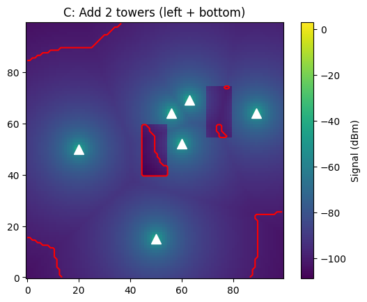
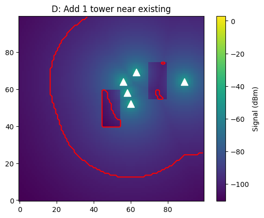

# dead-zone-simulator
Mobile network dead zone prediction simulator using Python
# Mobile Network Dead Zone Prediction Simulator

A Python simulation that predicts mobile network dead zones around the
SRM Institute of Science and Technology, Kattankulathur campus area, and tests
how tower placement changes coverage.

## Team
- K. Varshith Reddy (RA2311003010516)
- E. Dhanush (RA2311003010520)
- P. Mohit (RA2311003010522)

Faculty: Dr. Sathyapriya Loganathan
Department of Computing Technologies, SRM Institute of Science and Technology

## What it does
- Places 4 approximate Jio 4G tower positions (2300 MHz) on a 100 x 100 grid
  (about 22 m per cell, covering roughly 2.2 km x 2.2 km)
- Calculates signal strength at every point using a path-loss model
- Adds buildings as obstacles that cause extra signal loss
- Marks every point below -100 dBm as a dead zone
- Compares different tower layouts and reports the dead zone percentage

## How it works
1. Map the area to a grid and place the towers.
2. Signal (dBm) = Tx power - PL0 - 10 x n x log10(distance) - obstacle loss
3. Each point takes the strongest signal among all towers.
4. Points below -100 dBm are dead zones.

Settings used: Tx power 43 dBm, PL0 40 dB, path-loss exponent n = 3.5.

## Results
| Experiment | Towers | Dead zone |
|---|---|---|
| A: Original | 4 | 38.4% |
| B: +1 tower (left side) | 5 | 20.3% |
| C: +2 towers (left, bottom) | 6 | 9.1% |
| D: +1 tower (near existing) | 5 | 38.3% |

Main finding: tower placement matters more than the number of towers.
A tower added next to existing towers changed almost nothing, while towers
added in empty areas cut the dead zone sharply.

## Heatmaps
Upload the images to the repository, then these lines will show them:






## How to run
1. Open `dead_zone_simulator.ipynb` in Google Colab.
2. Run all cells (Runtime > Run all).

Or run it locally:
```
pip install numpy matplotlib
```

## Notes and limitations
- Tower positions are approximate, taken from site addresses on the
  Tarang Sanchar portal.
- Signal values are simulated, not measured.
- A simple distance-based model is used.

## Future work
- Validate with measured signal data
- Use the Okumura-Hata (COST-231) propagation model
- Add real building data from OpenStreetMap
- Add a machine learning model to predict weak areas
